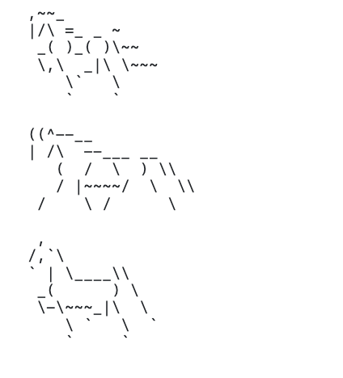

# Screenshot of ASCII Art to TXT Converter

## License

Original project code is available under the [MIT License](LICENSE).

Bundled fonts, sample artwork and other third party material retain their respective terms. See [dependencies and attribution](docs/DEPENDENCIES.md) and [source provenance](docs/provenance.md).

Experimental screenshot to text conversion for character art.

There are two decoders: one for a regular character grid and one for
proportional Saitamaar art. Choose the decoder yourself. Neither has been
validated across a broad range of real screenshots.

The grid decoder recovered 54 of 67 characters on one real screenshot. The
proportional decoder recovered 22 of 24 rows on one real screenshot after
normalizing spaces within blank runs. Details and sample commands are below.

## Corpus evaluation

On 12,816 ascii-art.de pairs with independently varied image margins of
0 to 31 pixels, the grid decoder recovered 112,909 of 217,049 rows exactly
(52.02%). Ignoring indentation, 153,396 rows matched (70.67%). The run had no
crashes. Image dithering and finding the grid origin remain sources of error.
These corpus results do not establish accuracy on arbitrary screenshots.

The AAHub dataset contains 32,950 matched pairs across 173 slugs at archive
commit `3687cc5`. Its split is recorded in `data/aahub_split.json`: 23,363
training pairs across 116 slugs and 9,587 evaluation pairs across 57 slugs.
The character prior contains 23,746,955 characters from the training text.
The corpus scripts read the pinned Git objects. They require a separate
dataset checkout that is not distributed with this repository.

```sh
python3 scripts/build_char_prior.py ../ascii-art-archive
python3 scripts/eval_corpus.py ../ascii-art-archive OUT --partition train --every 25 --size-px 16 --x0 8 --workers 4
python3 scripts/eval_fixed_grid_corpus.py ../ascii-art-archive FIXED-RECEIPT.json
```

The evaluation command writes results to `OUT/eval.json`. Use a new output
directory. Keep evaluation data separate from training and parameter tuning.
Results on generated images measure a different task from real screenshots.

Earlier results used a smaller dataset snapshot and sampled one page per
nonempty slug. Training results improved from 432/641 to 559/641 exact rows;
the separate evaluation sample improved from 271/357 to 278/357. Row counts
matched on all 41 sampled pages, with no loss of exact rows on any page.
Those figures describe that sample, not the current full corpus.

## How it works

The grid decoder measures the character lattice
from the image, infers the typeface and size by fitting a library of monospaced
fonts to that measured cell, and decides every cell by a recorded score. A cell is
written only when its best candidate beats the next candidate by a recorded margin;
otherwise it is `?`. It does not guess missing glyphs.

Cell aspect is measured rather than fixed. The tested geometries include 1:1,
1:2 and 16:29. The output records the measured aspect.

Tesseract is available through `--engine tesseract` for comparison. It is not
the default because prose OCR can introduce characters absent from the artwork.

## What the numbers are

Accuracy is measured two ways, because they answer different questions.

**Round-trip on synthetic sheets, where the source font is installed.** These
render text the pipeline has never seen, at a cell geometry it is not told, and
demand the characters back. Measured with Menlo on 2026-09-21:

| Sheet | Cell | Exact | Ambiguous | Reconstruction IoU | Typeface recovered |
|---|---|---|---|---|---|
| line art | 11 x 22 (1:2) | 40/40 (100%) | 0 | 0.992 | Menlo @ 19 |
| code | 8 x 9 (near square) | 27/29 (93%) | 0 | 0.866 | Menlo @ 13 |
| line art | 16 x 29 | 40/40 (100%) | 0 | 1.000 | Menlo @ 27 |

The fitted typeface and size matched the source in each of these three tests.

**A real screenshot with a manual transcript.** Measured September 21, 2026 on
`sample/bonsai.source.png`:

- **54 of 67 characters exact (80.6%)**, 1 ambiguous
- measured lattice 15.72 x 30.42 px, aspect 0.5168, inferred Menlo @ 26
- reconstruction agreement, ink IoU: 0.605

The remaining errors are reference-typeface errors, not structural ones: `=`
read as `-`, `#` as `=`, a trailing `_` lost to a space. The lattice and the
layout are right; the glyph shapes are approximated by the nearest installed
face.

That run also validates the self-check. Forcing Courier instead of the fitted
Menlo gives a *lower* agreement (0.544 against 0.605) and a *lower* true
accuracy (67.2% against 80.6%), so the reported IoU ranked the two fits in the
same order as the transcript score in this example. That does not establish
IoU as a reliable accuracy estimate for other images.

Add more pairs by dropping `<name>.source.png` and `<name>.expected.txt` into
`sample/` and extending `PAIRS` in `tests/test_roundtrip.py`. The suite gates
every pair at 75% exact.

**The bundled sample, where the source font is not installed.** The other sample is
Stone Story RPG art. Its typeface is a custom unnamed face that is not publicly
downloadable, so the fit necessarily lands on the nearest installed
approximation. No transcript has been supplied for this image, so no exact
accuracy can be quoted for it — only the self-consistency figures:

- measured lattice 11.560 x 21.510 px, aspect 0.5374, 37 columns
- inferred typeface SFNSMono @ 18px, residual 12.49
- 106 of 106 ink-bearing cells resolved
- reconstruction agreement, ink IoU: 0.557

The reference typeface does not match this image. Treat the output as an
approximation.

The bundled sample reports zero ambiguous cells despite that 0.557 agreement.
The margin threshold has not been calibrated for a mismatched font. Zero
ambiguous cells therefore does not mean the recovered characters are correct.

## Run the bundled sample

Requirements: Python 3.11+, NumPy, and Pillow. Tesseract is not required.

```sh
python3 -m pip install -r requirements.txt
./run-sample.sh /tmp/screenshot-of-ascii-art-to-txt-converter-output
```

The output directory must not already exist. A successful run creates:

- `machine-ocr.txt` — the recovered grid
- `quality.json` — measured lattice, inferred typeface, coverage, agreement
- `cell-decisions.json` — per-cell best, runner-up, margin, ink and state
- `reconstruction.png` — the recovered text re-rendered at the measured lattice

The bundled calibration file is passed as a **prior only**. The lattice is
measured from the image, and the receipt records how far the measurement fell
from the declaration.

## Current bundled result

Source image:



Observed on 2026-09-21:

<!-- observed-output-start -->
```text
   ,--_
   |/\ =_ _ ~
    _( )_( )\~~
    \,\  _|\ \~~~
       \`   \
       `    `

   ((^--__
   | /\  --___ __
      (  /  \  ) \\
      / |~~~~/  \  \\
    /    \ /      \

    ,
   /,`\
   ` | \____\\
    _(      ) \
    \-\~~~_|\  \
       \ `   \  `
       `     `
```
<!-- observed-output-end -->

This output is a machine candidate, not an accepted reconstruction.

## Proportional (Shift_JIS) art

`recover_monospace_ascii.py` refuses art set in a proportional face, because no
single advance describes it. `scripts/recover_proportional_aa.py` decodes it
instead, assuming the art was set in Saitamaar (the MS PGothic-metric face that
2ch/5ch art viewers use, vendored under `fonts/`). Each row is decoded by
dynamic programming over the pen positions that the font's advance table
allows. The font size, line pitch, text-box origin and row baselines are all
fitted from the image and recorded in `quality.json`. It also needs fontTools
(pinned in `requirements.txt`).

```sh
python3 scripts/recover_proportional_aa.py sample/proportional/madonna.source.png OUT
python3 scripts/score_against_key.py OUT/recovered.txt sample/proportional/madonna.expected.txt
```

On the one real screenshot with an answer key, 22 of 24 rows come out exact and
the character error rate is 0.56%. That comparison ignores the order of spaces
within a blank run, which the pixels do not determine. The strict character
error rate is 1.61%. This is one sample in one face, so the result is
experimental. See `docs/receipts/2026-09-26-proportional-madonna/`.

## Coverage accounting

Coverage is measured against source cells containing ink. A space inside the
ink region is scored as a blank template decision. Counting only emitted
characters would miss source cells incorrectly dropped as spaces.

## Repository contents

This repository contains the converter, one bundled sample image, calibration
data, tests, and the comparison GIF. It does not include the larger LateLetter
application or unrelated application data.

The comparison GIF in `docs/` still shows the old Tesseract-era result and needs
regenerating.

See [docs/provenance.md](docs/provenance.md) for source information and
[docs/DEPENDENCIES.md](docs/DEPENDENCIES.md) for runtime dependencies and licenses.
